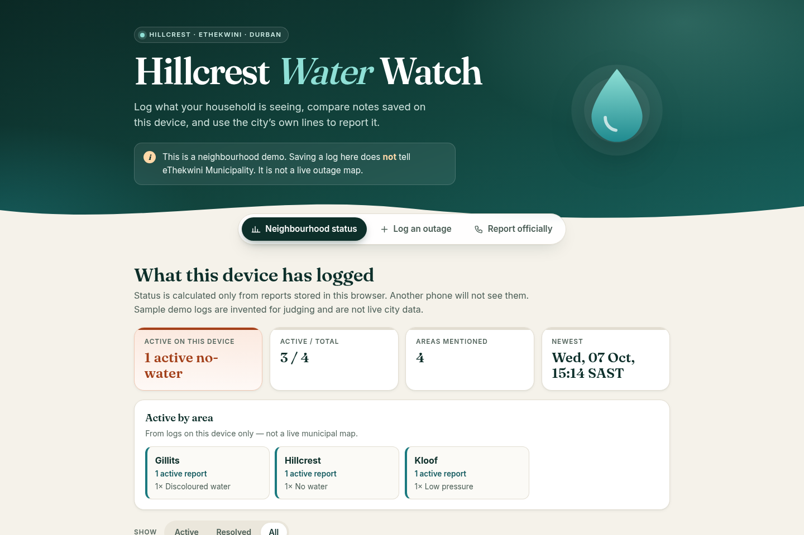
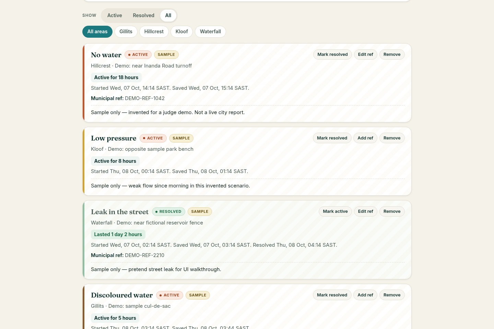
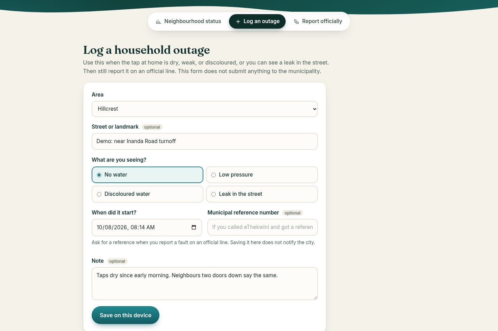
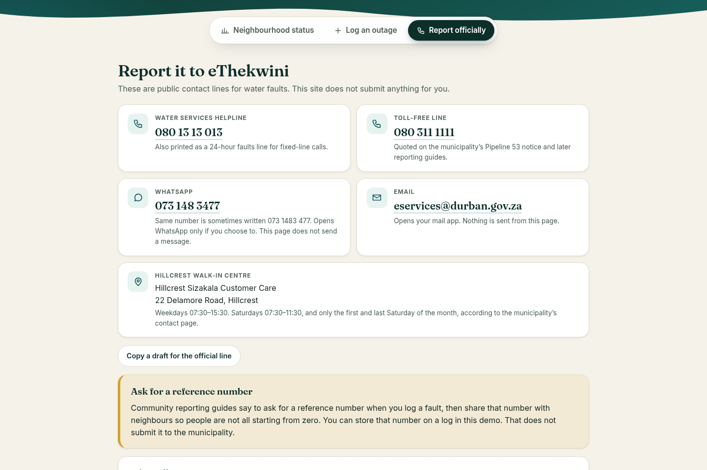

# Hillcrest Water Watch

A small, offline-friendly website that helps households in Hillcrest and the wider Outer West of eThekwini (Durban, South Africa) keep a plain record of water outages and get to the official places to report them.

Built solo by Amy Elgin for the WarriorHacks 2.0 hackathon track (theme: a real issue in your community).

## Try it

- Live demo: (GitHub Pages link goes here once Pages is switched on)
- Or download the repo and open `index.html` in any browser. There is no build step, no server, and no account.
- Open `index.html#demo` to load clearly labelled **sample** logs and start on the status view. Sample logs are invented scenarios for judges, not live city data.

## The problem

Hillcrest sits in the Outer West of eThekwini Municipality (Durban, South Africa). When a household loses water, neighbours often hear about it in chats, while the fault itself still has to be logged with the municipality.

A documented example: from 26 January 2025 until 22 February 2025, eThekwini warned of restrictions because Pipeline 53 was shut so it could be relocated during SANRAL’s N3 upgrade. Umgeni-Uthukela Water had isolated the pipeline, reducing flow from the DV Harris Water Treatment Plant. The city’s area list included Hillcrest, plus nearby Crestholme, Waterfall, Kloof, Gillits, Bothas Hill, Shongweni, and Molweni.

That notice is not a claim about whether water is off today. This demo does not invent outage counts, population figures, or leak percentages.

## What it does

- A household can log no water, low pressure, discoloured water, or a street leak, with an area, an optional landmark, a start time, an optional municipal reference number, and a short note.
- Reports can be marked resolved or active again. Filters cover status and area.
- A neighbourhood status view summarises only the logs saved in **this browser**, including an active-by-area breakdown. Another device cannot see them unless you export/import the JSON file. There is no live municipal feed.
- Official eThekwini contact lines are listed so a person can report the fault themselves. The page does not call, email, WhatsApp, or submit a form. A copyable draft for the official line can be built from active logs.
- A plain-text summary can be copied. Logs can be exported or imported as JSON between devices. The site does not send either.
- Sample demo logs can be loaded for a judge walkthrough; they carry a Sample badge and invented place names.

Area names in the form are places named on the Pipeline 53 notice, not a complete suburb directory.

## How it's built

Plain HTML, CSS and JavaScript (`index.html`, `css/styles.css`, `js/app.js`), with no frameworks or build step. Logs are stored in the browser's `localStorage` on that device only; export and import use a JSON file. Nothing is sent to a server, and the site never contacts the municipality on anyone's behalf.

Accessibility and speed were checked with Lighthouse 12 (mobile, 8 October 2026): accessibility 100, best practices 100, SEO 100, performance 99–100, with no layout shift. The section tabs follow the ARIA tabs pattern, so arrow keys, Home and End move between them, and text colours meet the 4.5:1 contrast ratio. The two fonts, Fraunces and Inter, are self-hosted in `fonts/` under the SIL Open Font License (licence files included), so the page needs no third-party requests.

## Screenshots

| | |
| --- | --- |
|  |  |
|  |  |

## Sources for water facts

Used on the site:

- Pipeline 53 notice, including the Hillcrest area list and the lines 080 311 1111, WhatsApp 073 1483 477, and the city email, as republished from the municipality: https://www.constructionsafety.co.za/2025/01/30/the-ethekwini-municipality-warns-of-water-supply-restrictions-due-to-the-shutdown-of-pipeline-53/
- Municipal statement URL cited by that article (direct fetch from this environment timed out): https://www.durban.gov.za/press-statement/Pipeline+shutdown+may+lead+to+water+supply+restrictions+in+various+parts+of+the+city
- How to report a water fault (080 13 13 013, 080 311 1111, WhatsApp 073 148 3477, eservices@durban.gov.za): https://sundayindependent.co.za/news/south-africa/2025-04-17-how-do-i-report-a-water-fault-to-ethekwini-here-is-what-you-need-to-know/
- Same numbers, plus the suggestion to ask for a reference number: https://www.fixlocal.org.za/content/370
- Hillcrest Sizakala Customer Care, 22 Delamore Road, and the weekday/Saturday hours, from the indexed text of https://www.durban.gov.za/pages/search/contact-us (also repeated on the indexed water-and-sanitation page). A direct fetch of that contact URL returned 404 from the fetch tool, and the box could not complete the site’s TLS chain, so the address and hours were taken from the search index excerpt of the official page, not from a full HTML download.

Left out on purpose: population totals, “percent of water lost” figures, and any claim that a October 2026 Southern Aqueduct shutdown includes Hillcrest. That October notice’s area lists, in the articles checked, name other parts of the city.
